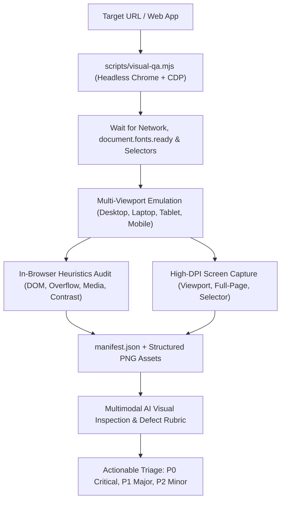

# Universal Visual Quality Assurance (Visual QA) Skill

The **Visual QA Skill** equips Antigravity (`agy`) agents with automated, multimodal visual inspection capabilities for any web application. It combines automated headless browser orchestration (via Google Chrome and the Chrome DevTools Protocol) with systematic heuristic defect detection and multimodal visual analysis.



---

## 1. Quick Start: Headless Capture CLI

The companion CLI script [`scripts/visual-qa.mjs`](file:///Users/sadeq/projects/tripplanner/scripts/visual-qa.mjs) captures high-resolution screenshots across standard responsive breakpoints and performs an automated in-browser visual defect heuristic audit.

### Basic Multi-Viewport Capture (Desktop, Tablet, Mobile)
```bash
node scripts/visual-qa.mjs --url=http://localhost:4321 --outDir=scratch/visual-qa
```

### Full Responsive Suite with Full-Page Capture
```bash
node scripts/visual-qa.mjs \
  --url=http://localhost:4321 \
  --viewports=all \
  --fullPage \
  --outDir=scratch/visual-qa-full
```

### Component / Region of Interest Capture
```bash
node scripts/visual-qa.mjs \
  --url=http://localhost:4321 \
  --selector="#itinerary-map" \
  --waitForSelector=".leaflet-tile-loaded" \
  --delay=1500 \
  --outDir=scratch/visual-qa-component
```

---

## 2. Standard Responsive Breakpoints

Visual defects frequently emerge at viewport transitions. The skill enforces testing across four standard industry breakpoints:

| Breakpoint | Viewport Dimensions | DPR (Scale) | Emulation Flag | Typical Target Device |
| :--- | :--- | :--- | :--- | :--- |
| **Desktop** | `1440 × 900` | `1x` | Desktop | 24–27″ Monitor / Full Browser Window |
| **Laptop** | `1280 × 800` | `1x` | Desktop | 13–14″ MacBook Air / Ultrabook |
| **Tablet** | `768 × 1024` | `2x` | Mobile + Touch | iPad 9.7″ / iPad Mini (Portrait) |
| **Mobile** | `375 × 812` | `3x` | Mobile + Touch | iPhone X / 11 / 12 / 13 / Mini |

---

## 3. Systematic Defect Classification Rubric

Defects identified during automated audits or multimodal inspections must be categorized using the following severity rubric:

### 🔴 P0 — Critical (Immediate Blocker)
*Visual defects that break application usability, destroy core layouts, or expose severe production defects.*
- **Unconstrained Media Page Blowout**: An ``, `<video>`, or `<canvas>` expanding to its natural pixel width (>1000px) and forcing severe horizontal scrollbars across the entire page.
- **Cartographic Watermark & Broken Maps**: Missing map tiles (HTTP 401/403/404), gray canvas placeholders, or "For development purposes only" / "Map data not available" watermark overlays.
- **Unusable Mobile Layout**: Core action buttons, forms, or navigation menus completely inaccessible or clipped offscreen on mobile viewports (`375×812`).
- **Modal Lockout**: Active modal backdrop obscuring content with no close trigger visible or clickable.

### 🟡 P1 — Major (Degraded User Experience)
*Defects that compromise visual polish, cause readability degradation, or hinder navigation.*
- **Horizontal Page Scrollbar**: `scrollWidth > clientWidth` on viewport without responsive containment (`overflow-x: hidden`).
- **Text Truncation / Clipping**: Descending characters (`g, y, p, q, j`) cut off by tight `line-height` or `overflow: hidden`, or button labels cut off mid-word.
- **Distorted Media Aspect Ratio**: Images or videos stretched or squished (skew > 8% between natural aspect ratio and rendered aspect ratio without `object-fit: cover` or `contain`).
- **FOUT / Font Fallback Glitch**: Custom typography failing to load and flashing default Times New Roman or serif fallbacks, shifting layout dimensions.
- **Sub-standard Touch Targets**: Critical interactive buttons or links smaller than `36×36px` on tablet or mobile viewports.

### 🔵 P2 — Minor (Visual Polish & Cosmetics)
*Non-blocking visual flaws, minor asymmetries, or accessibility enhancements.*
- **Low Contrast Text (WCAG AA)**: Secondary captions, timestamps, or placeholder text failing the 4.5:1 contrast threshold (or 3:1 for large text).
- **Subtle Alignment Offset**: Adjacent cards, badges, or icons misaligned by 1–3px.
- **Excessive Sticky Header Height**: Fixed top bar consuming >25% of mobile screen real estate.
- **Asymmetric Margins / Padding**: Visual imbalance in column gutters or card padding.

---

## 4. Universal Visual Defect Heuristics

When inspecting captured screenshots and analyzing manifest data, evaluate the five core pillars of visual quality:

### Pillar 1: Layout Stability & Aspect Ratios
1. **Unconstrained Media Dimensions**:
   - Check if ``, `<video>`, `<svg>`, or `<canvas>` have explicit responsive constraints:
     ```css
     img, video, canvas {
       max-width: 100%;
       height: auto;
     }
     ```
   - Watch for elements blowing out flex containers. Flex items default to `min-width: auto`, which prevents children from shrinking below their content size. Fix by setting `min-width: 0` on flex items.
2. **Aspect Ratio Preservation**:
   - Ensure photos use `object-fit: cover` or `object-fit: contain` when placed in fixed-dimension cards.
   - Verify that natural aspect ratios (`img.naturalWidth / img.naturalHeight`) match rendered ratios within 5%.
3. **Cumulative Layout Shift (CLS)**:
   - Elements must reserve layout space via `aspect-ratio` or `width`/`height` attributes to avoid jarring shifts when images or map tiles load.

### Pillar 2: Typography & Web Font Rendering
1. **Font Loading State**:
   - Always await `document.fonts.ready` before visual capture.
   - Detect FOUT (Flash of Unstyled Text) by verifying `@font-face` declarations and checking `document.fonts.status === 'loaded'`.
2. **Text Clipping & Ellipsis Boundaries**:
   - Inspect elements with `text-overflow: ellipsis` or `overflow: hidden` to confirm they provide sufficient vertical line-height (`line-height: 1.4` minimum for Latin scripts).
   - Ensure single-word orphan wrapping does not produce awkward one-letter lines.
3. **WCAG AA Contrast Compliance**:
   - Calculate relative luminance:
     $$L = 0.2126 \cdot R + 0.7152 \cdot G + 0.0722 \cdot B$$
   - Body copy (<18pt) requires a contrast ratio $\ge 4.5:1$.
   - Large text ($\ge 18\text{pt}$ or $\ge 14\text{pt}$ bold) requires a contrast ratio $\ge 3.0:1$.
   - Pay special attention to text overlaid on hero images: ensure dark gradient scrims (`linear-gradient(to top, rgba(0,0,0,0.7), transparent)`) are present.

### Pillar 3: Cartographic & Graphic Integrity
1. **Basemap Tile Completion**:
   - Check Leaflet (`.leaflet-tile`), Mapbox (`.mapboxgl-canvas`), or OpenStreetMap instances.
   - Verify zero 404/403 tile failures and zero blank grid tiles.
2. **Map Markers & Anchor Coordinates**:
   - Pins must remain anchored to exact latitude/longitude coordinates during zoom/pan transitions.
   - Marker popup tooltips must not clip outside the map container boundaries.
3. **Polyline & Route Rendering**:
   - Route overlays must render smooth, anti-aliased SVG strokes without jagged vertex artifacts.

### Pillar 4: Responsive Breakpoints & Mobile Adaptability
1. **Navigation Transformation**:
   - Desktop horizontal nav strips must gracefully collapse into accessible hamburger menus or bottom sheets on screens $\le 768\text{px}$.
2. **Horizontal Overflow Immunity**:
   - The document root (`<html>`, `<body>`) must maintain `scrollWidth === clientWidth`.
   - Data tables or pill lists intended to scroll horizontally must be isolated within dedicated container elements with `overflow-x: auto; -webkit-overflow-scrolling: touch;`.
3. **Touch Targets**:
   - Interactive elements on mobile/tablet viewports must meet the minimum target size of $44 \times 44\text{px}$ (Apple HIG) or $48 \times 48\text{px}$ (Google Material).

### Pillar 5: Interactive States & Overlays
1. **Stacking Context & Z-Index Layering**:
   - Dropdown menus and date pickers must appear *above* interactive maps (`z-index: 1000+` in Leaflet).
   - Fixed/sticky headers must not overlap modal dialogs.
2. **Modal Viewport Containment**:
   - Modals on mobile screens must have `max-height: 90vh` and internal scrolling (`overflow-y: auto`) to prevent action buttons from being pushed beneath the viewport edge.
3. **Sticky Header Offset**:
   - When anchor navigation scrolls to a section, ensure `scroll-padding-top` matches or exceeds the sticky header's rendered height.

---

## 5. Step-by-Step AI Agent Execution Protocol

When instructed to verify the visual quality of a web application, follow this standardized execution protocol:

### Step 1: Pre-Flight Application Check
1. Verify the web application server is running:
   ```bash
   curl -s -I http://localhost:4321/
   ```
2. If inactive, start the application dev server or notify the user.

### Step 2: Automated Multi-Viewport Capture & Audit
Execute the headless capture CLI tool against the target URL:
```bash
node scripts/visual-qa.mjs \
  --url=http://localhost:4321 \
  --viewports=desktop,tablet,mobile \
  --outDir=scratch/visual-qa
```
This produces:
- `scratch/visual-qa/localhost_desktop_1440x900.png`
- `scratch/visual-qa/localhost_tablet_768x1024.png`
- `scratch/visual-qa/localhost_mobile_375x812.png`
- `scratch/visual-qa/manifest.json` (Structured defect heuristics report)

### Step 3: Inspect Manifest Heuristics
Read the generated `manifest.json` to immediately identify any programmatic flags:
- `summary.hasHorizontalOverflow`: Boolean indicating unintended horizontal page blowout.
- `summary.brokenImagesCount`: Number of `img` tags with failed sources.
- `summary.distortedImagesCount`: Images with unpreserved aspect ratios.
- `summary.lowContrastElementsCount`: Text elements failing WCAG AA contrast.
- `summary.cartographicIssues`: Basemap tile or watermark errors.

### Step 4: Multimodal Visual Inspection
Examine the captured PNG screenshots:
- Inspect alignment, hierarchy, typography, visual weight, and whitespace consistency.
- Compare the Desktop vs Mobile captures to identify elements that crowd, clip, or wrap awkwardly on smaller viewports.
- If an interactive component (e.g., modal, filter popover) needs testing, use `--selector` or trigger the state before capturing.

### Step 5: Deliver Actionable Triage Report
Format the findings into a clear, structured report:
```markdown
### Visual QA Inspection Summary
- **Target URL**: `http://localhost:4321`
- **Breakpoints Tested**: Desktop (1440×900), Tablet (768×1024), Mobile (375×812)
- **Status**: 🟢 Clean / 🟡 Warnings / 🔴 Action Required

#### Defects Found:
1. **[P1] Distorted Aspect Ratio on Place Thumbnail**
   - **Viewport**: Mobile (375×812)
   - **Selector**: `.stop-card img.place-thumbnail`
   - **Defect**: Image rendered at 74×74px from 600×400px source without `object-fit: cover`, squishing pixels.
   - **Remediation**: Add `object-fit: cover; border-radius: 8px;` to `.stop-card img.place-thumbnail`.

2. **[P2] Low Contrast on Status Pill**
   - **Viewport**: All
   - **Selector**: `span.session-pill`
   - **Defect**: Text contrast ratio is 2.87:1 (expected $\ge 4.5:1$).
   - **Remediation**: Update foreground color from `#93c5fd` to `#1d4ed8` or darken container background.
```

---

## 6. CLI Reference for `scripts/visual-qa.mjs`

```
OPTIONS:
  --url=<url>               Target web page URL (default: http://localhost:4321)
  --outDir=<dir>            Destination directory for PNG captures and manifest.json
                            (default: ./scratch/visual-qa)
  --viewports=<list>        Comma-separated viewports: desktop,laptop,tablet,mobile,all
                            Or custom dimension <width>x<height> (e.g. 1920x1080)
                            (default: desktop,tablet,mobile)
  --delay=<ms>              Additional settle delay in ms after fonts & selector ready
                            (default: 1000)
  --waitForSelector=<sel>   Wait for matching CSS selector to be visible in DOM
  --fullPage                Also capture full document scroll-height screenshot
  --selector=<sel>          Crop screenshot to the bounding box of a specific element
  --audit                   Run automated in-browser visual QA defect heuristic audit
                            (default: true)
  --no-audit                Disable in-browser visual audit
  --chromePath=<path>       Explicit path to Google Chrome binary
  --prefix=<name>           Filename prefix (default: page or slug from URL)
  --deviceScaleFactor=<n>   Override DPR device scale factor
  -h, --help                Show help message
```

---

## 7. Common CSS Remediation Patterns

| Defect Pattern | Symptom | Immediate CSS Remediation |
| :--- | :--- | :--- |
| **Media Blowout** | Natural image width forces horizontal scrolling | `img, video, canvas { max-width: 100%; height: auto; }` |
| **Flex Item Overflow** | Child element inside flex container refuses to shrink | `.flex-child { min-width: 0; flex-shrink: 1; }` |
| **Image Distortion** | Rendered square thumbnail squishes landscape photo | `img { width: 100%; height: 100%; object-fit: cover; }` |
| **Descender Clipping** | Letters like `g, j, p, q, y` cut off at baseline | `line-height: 1.4; padding-bottom: 2px;` |
| **Sticky Header Overlap** | In-page `#hash` jumps slide under fixed navigation | `html { scroll-padding-top: var(--header-height, 64px); }` |
| **Z-Index Layering** | Dropdown menu slips behind Leaflet/Mapbox canvas | `.dropdown-menu { z-index: 1001; } /* Leaflet tiles are 400 */` |
| **Mobile Modal Lockout** | Bottom action buttons unreachable on small screens | `.modal-body { max-height: calc(100vh - 120px); overflow-y: auto; }` |
| **Uncontained Scroll** | Pill tab bar pushes page width wider than screen | `.tab-bar { overflow-x: auto; white-space: nowrap; max-width: 100%; }` |
